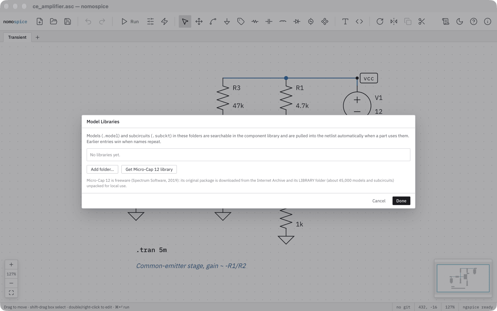
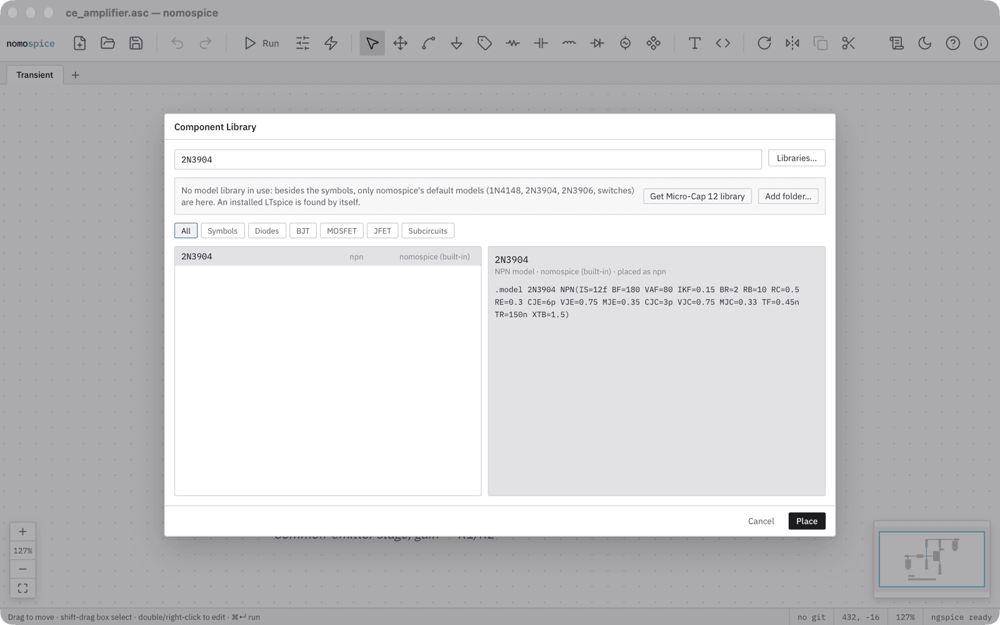

# Use model libraries

nomospice has its own symbols and a few default models: the diode 1N4148, the transistors 2N3904 and 2N3906, and switches. For other parts, add a model library: a folder of `.lib`, `.sub` and similar files with `.model` and `.subckt` definitions.

## Add a library

Press ++cmd+comma++ (nomospice → Model Libraries… on macOS, File → Model Libraries… on Windows), or click *Libraries…* in the component library.

- **Add folder…** adds a folder of your own. Its models and subcircuits become searchable and are pulled into the netlist when a part uses them.
- **Get Micro-Cap 12 library** downloads the freeware Micro-Cap 12 package from the Internet Archive (about 60 MB) and unpacks its library, about 45,000 models and subcircuits, for local use.

When two libraries define the same name, the one listed first wins. Untick a library to switch it off without removing it.

## Find and place a part

Press ++p++ (or ++f2++, ++cmd+k++) for the component library and type a name. The tabs narrow the list to symbols, diodes, BJTs, MOSFETs, JFETs or subcircuits; the right side shows a part's description and pins. Click *Place* and put the part down like any other.

A subcircuit without a symbol of its own gets a generated box symbol with its pins. Its definition, and the definitions it depends on, go into the netlist by themselves.

## Give a part another model

Right-click a diode, transistor or MOSFET and choose *Choose model from library…*. The component library opens on that kind of part; the one you pick replaces the part's model.
