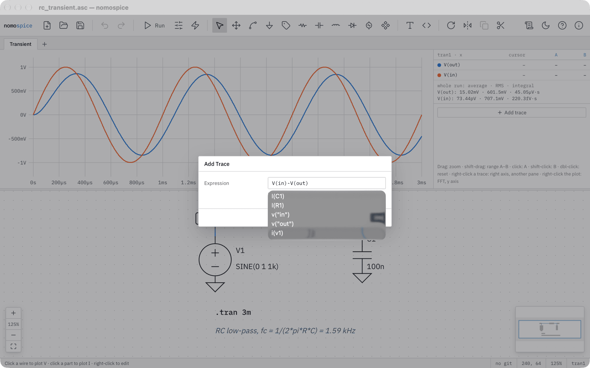
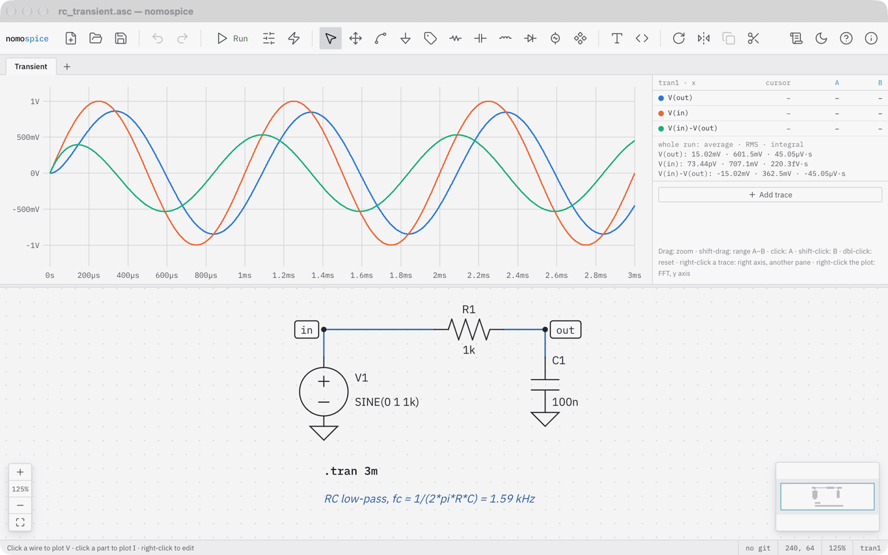
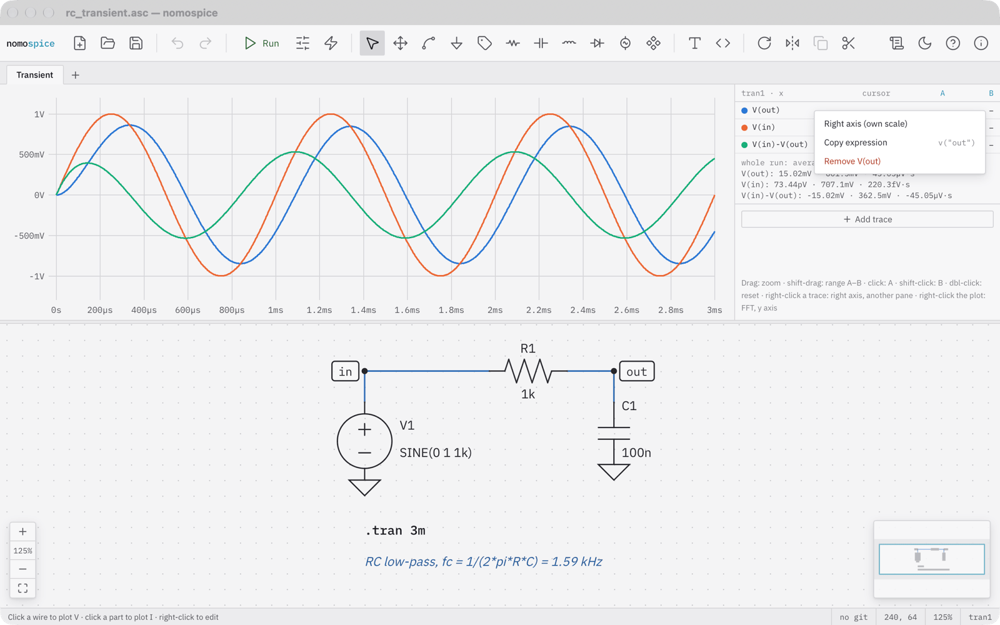
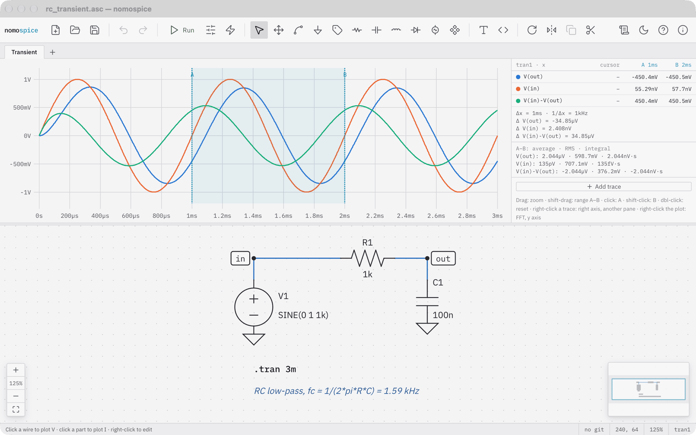
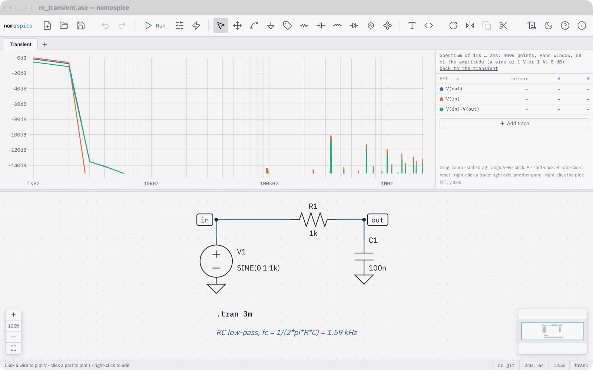

# Plot and measure

## Plot by clicking

After a run, the schematic is a probe:

- click a **wire** to plot its voltage;
- drag from one **wire** to another to plot the voltage between them, `V(a,b)`: the red probe sits where you pressed, the black one where you let go (on ground: plain `V(a)`). While results are shown, a drag that starts on a wire or a label probes; to move one, use the move tool (++m++);
- click a **part** to plot its current, in transient, DC and AC analyses alike;
- click **near a pin** of a transistor or an IC to plot that pin's current, such as `Ib(Q1)` or `Ix(U1:OUT)`;
- right-click a two-pin part and choose *Plot power* for the power it takes (transient and DC analyses).

Each unit gets a pane of its own: volts, amperes, watts.

## Plot an expression

Click *Add trace* beside the plot and type an expression in ngspice's syntax: `V(in)-V(out)`, `I(R1)`, `V(in)*I(R1)` (in watts), `P(R1)+P(R2)` (two-pin parts' power, as *Plot power* draws it; transient and DC analyses), `db(V(out))`, `group_delay(V(out))`. The unit follows from the expression. A constant, such as `0.5`, draws a reference line.

## Arrange traces

Right-click a trace's row in the table beside the plot to put it on a right axis with a scale of its own, to move it into another unit's pane, to plot the group delay of an AC result, to copy its expression, or to remove it.

## Measure with cursors

- Click to set cursor A, shift-click to set cursor B. The table shows each trace at both cursors, their difference Δ, and 1/Δx.
- Shift-drag marks a range A–B; the table shows each trace's average, RMS and integral over it.
- Drag to zoom, use the wheel or a trackpad to zoom and pan, double-click to see everything again.

For measurements you want every run, write a `.meas` directive (press ++s++, then the *Measurement* tab): its result is listed beside the plot.

## Look at the spectrum

Right-click a transient plot and choose *FFT (spectrum)*: the spectrum of the range between the cursors A and B, else of what is shown, with a Hann window and in decibels of the amplitude. *FFT settings…* in the same menu chooses the window (Hann; rectangular for a whole number of periods; Hamming; Blackman-Harris for small lines beside big ones; flat top for exact amplitudes), the amplitude in dB or as it is (volts, amperes), and the number of points. *Back to the transient* returns.

## Arrange the axes

The plot's menu switches a frequency axis between logarithmic and linear, sets the x range by number (*X range…*), hides an AC result's phase (*Hide the phase*: the magnitude alone) and marks the points the simulator computed (*Mark data points*). A trace's menu puts it *Into a pane of its own*, so input and output, both in volts, are shown one above the other.

## Two-port quantities

With `.net I(R1) V1` beside an `.ac` analysis (V1 the source and the only AC source, with an Rser as the reference impedance; R1 the load), *Add trace* offers `S21(V1)`, `S11(V1)` and `Zin(V1)`: transmission, reflection and the input impedance in dB and phase (`mag(Zin(V1))`: the input impedance in ohms).

## Other choices in the plot's menu

Right-click the plot for the y axis (logarithmic, or a fixed range), copying the data as CSV, exporting the plot as SVG or all results as a `.raw` file, and for AC results the Nyquist and Nichols plots.
