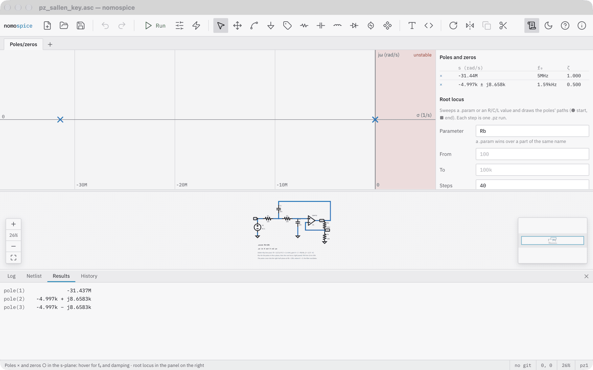

# Find poles and zeros

A `.pz` analysis finds the poles and zeros of a transfer function between two pairs of nodes.

## Run it

Open the simulation command (the sliders in the toolbar), choose *Poles/zeros*, and give the input and output nodes. Or write the directive yourself, for example `.pz in 0 out 0 vol pz`: voltage in, voltage out, poles and zeros. The example pz_sallen_key is a second-order Sallen-Key low-pass.

The result is a map of the s-plane: × marks a pole, ○ a zero, and the right half, where a pole means the circuit is unstable, is shaded. Hover a pole for its frequency f₀ and damping ζ. The table on the right lists them all, and *Results* in the bottom panel lists the raw values.

## Draw a root locus

The root locus shows how the poles move while one value changes. In the panel on the right, give

- **Parameter**: a `.param` name or a resistor, capacitor or inductor (such as `R1`),
- **From**, **To** and the number of **Steps**, spaced logarithmically or linearly,

and click *Draw root locus*. nomospice runs one `.pz` analysis per step and draws each pole's path, from a dot at the start to a square at the end. Halt stops it; *Clear* removes it.

Drag to pan the map, use the wheel to zoom, double-click to fit it again.
