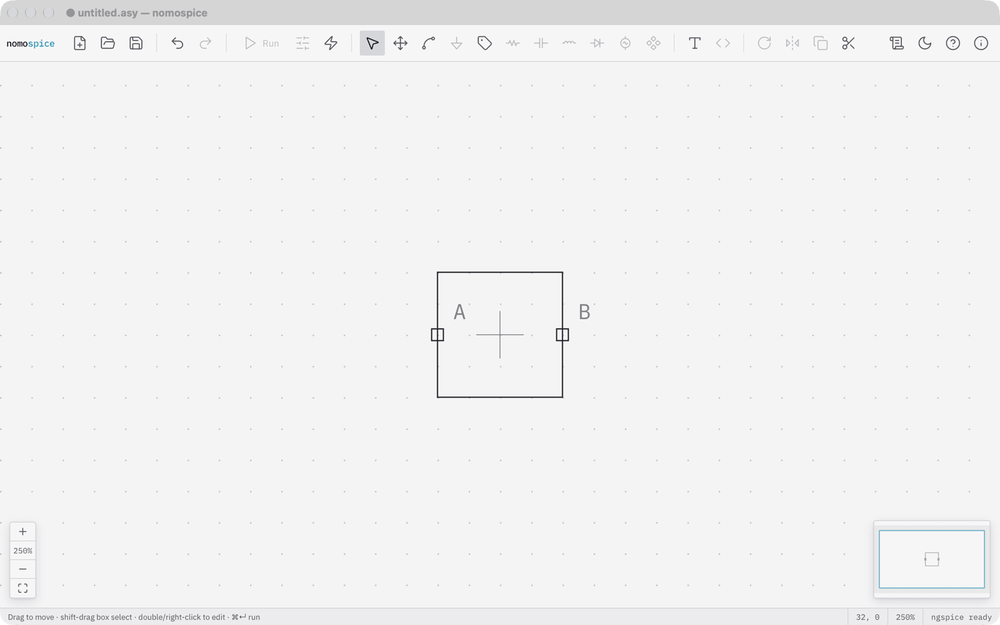
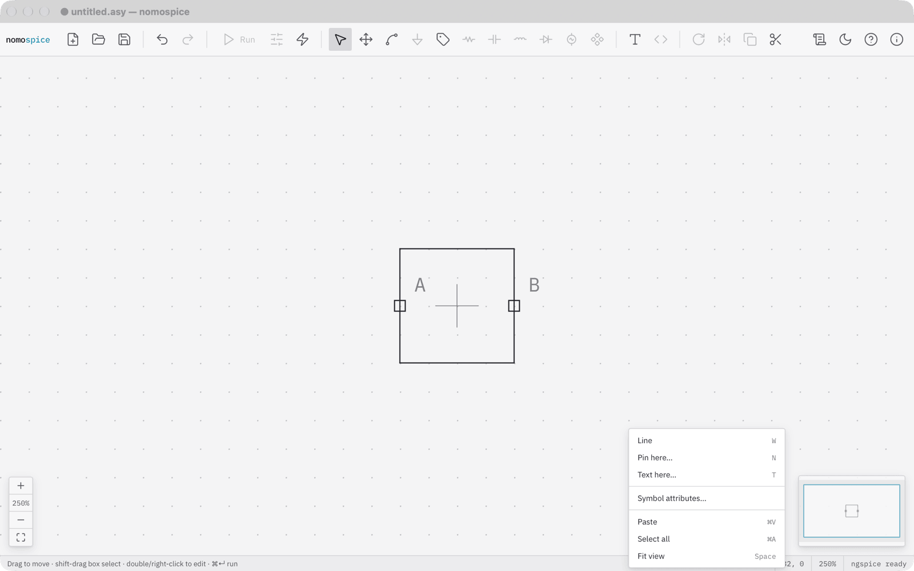
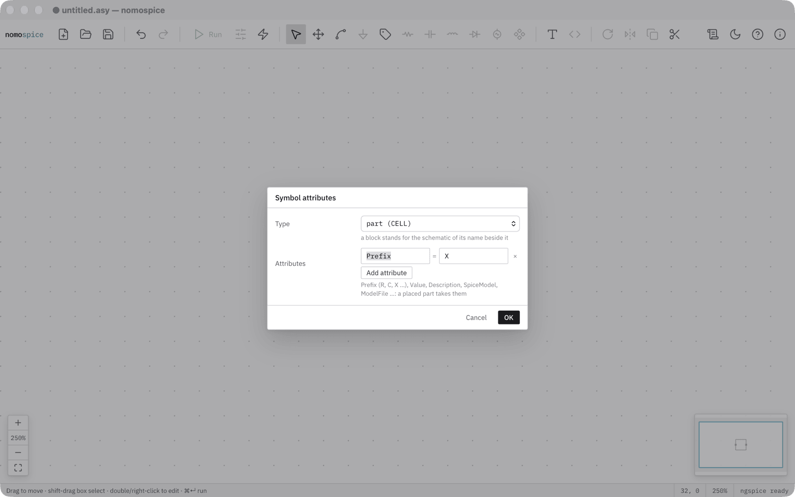

# Draw and edit symbols

A symbol (`.asy`) is how a part looks in a schematic and where its pins are. nomospice edits symbols on the same canvas as schematics.

## Open a symbol

- Open an `.asy` file with ++cmd+o++, or
- right-click a part and choose *Edit its symbol* (for a symbol from the schematic's folder), or
- choose File → New Symbol, or *New symbol* in the canvas menu, to start an empty one.

## Draw it

- **Lines**: press ++w++ and click from point to point. A line can go at any angle. It ends when it reaches the end of another line or a pin; press ++esc++ to end it anywhere.
- **Pins**: press ++n++, give the pin a name, and click where it goes. In the pin's dialog, *Name shown* sets where the name appears on a placed part, or hides it.
- **Text**: press ++t++ for a comment.
- Move, copy and delete lines, pins and texts like parts. The cross marks the symbol's origin: where a placed part sits on the grid.

## Set its attributes

Right-click the canvas and choose *Symbol attributes…*.

- **Type**: *part* (a component) or *block* (stands for the schematic of its name beside it; see [Your own block](../tutorial/blocks.md)).
- **Attributes**: *Prefix* (R, C, X …), *Value*, *Description*, *SpiceModel*, *ModelFile* and others. A placed part takes them as its defaults.

## Save it

++cmd+s++ saves the symbol. A new symbol's first save asks where; put it beside the schematics that place it. Its name is how schematics refer to it: one word, and not the name of a built-in symbol. Every open window with a schematic in the same folder draws the saved symbol anew.
