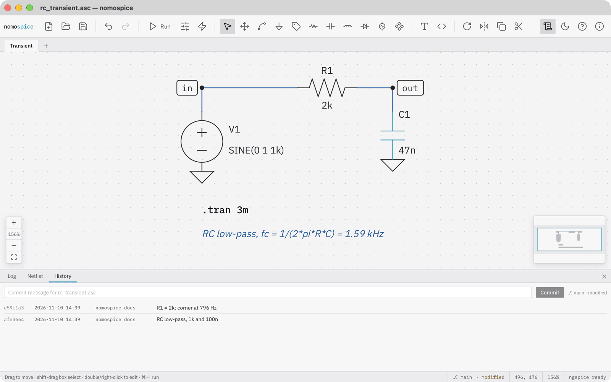
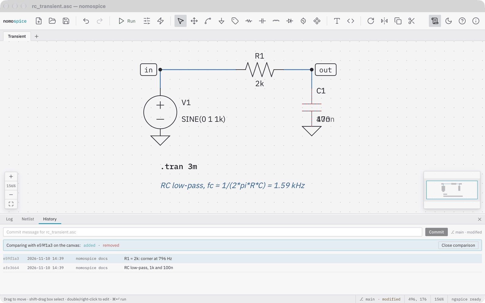

# Keep a version history

If a schematic lies in a git repository, nomospice shows its state and keeps a history of it. You need git installed.

## See the state

The status bar shows the branch and whether the file is modified or not yet tracked. A schematic outside a repository shows *no git*; click it to open the History panel, where *Initialize repository* makes its folder a repository.

## Commit

Open the History panel: View → Version History, or click the git state in the status bar. Save the schematic, type a message and click *Commit*. The list shows the commits of this file, the newest first.

## Compare and restore

Click *Compare* beside a commit: the canvas shows what has been added and removed since then, highlighted. *Close comparison* ends it.

*Restore* replaces the schematic with that version. It is an ordinary edit: ++cmd+z++ takes it back, and nothing is written until you save.
