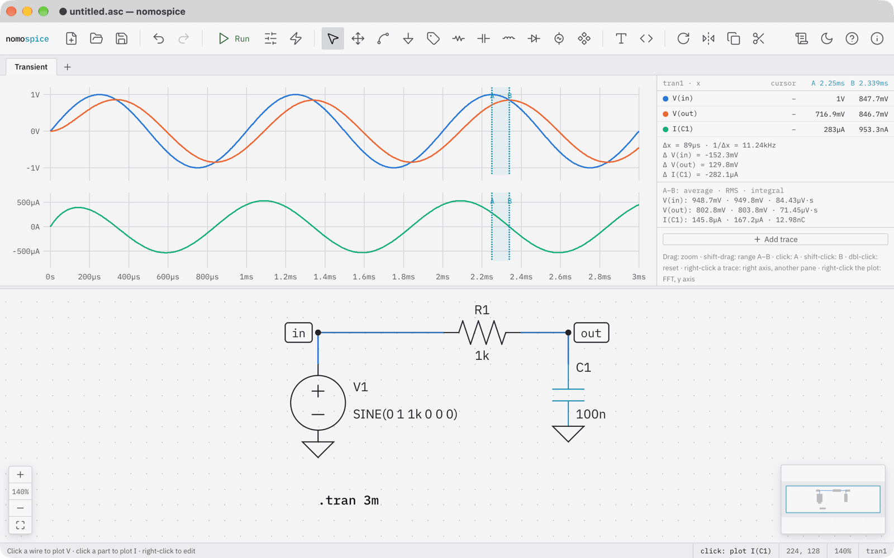

# nomospice

**nomospice is a circuit simulator with schematic capture and click-to-probe waveforms.** You draw a circuit, run it with ngspice, and click a wire or a part to plot its voltage or current. It reads and writes the widespread `.asc` schematic format, writes SPICE for you through forms that show what they write, and runs on macOS, Windows and Linux.

## Where to go

- **[Tutorials](tutorial/index.md)**: learn nomospice by doing. Four short lessons, from a first simulation to your own blocks.
- **[How-to guides](how-to/index.md)**: recipes for particular tasks, such as using a model library, measuring with cursors, poles and zeros, or several windows.
- **[Reference](reference/index.md)**: every key and menu item, the analyses and directives, the plot window, files, and the command line.
- **[Explanation](explanation/index.md)**: how a simulation runs, how blocks become subcircuits, and how nomospice relates to other simulators.

## Get it

[Install](install.md) the signed macOS app or the Windows installer from the [releases](https://github.com/mprotogerakis/nomospice/releases). Both include ngspice and update themselves. nomospice is free software under the AGPL-3.0-or-later.
