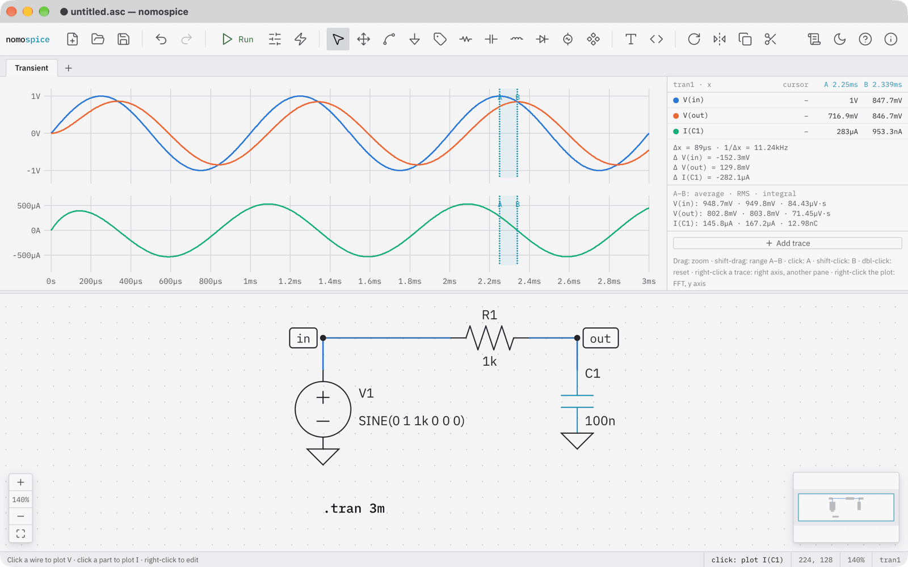

# The plot window

After a run with results over time, frequency or a sweep, the plot opens above the schematic. Drag the bar between them to share the space differently.

## Panes and axes

- Each unit has a pane of its own; the panes share the x axis and zoom together.
- A trace can go on the pane's right axis, with a scale of its own, or into another unit's pane (on its right axis there).
- AC results have two panes, magnitude in dB and phase in degrees, over a logarithmic frequency axis.
- A `.step` makes every trace a family of curves, one per step; the table lists the steps.

## The table beside the plot

- one row per trace, with its value at the mouse, at cursor A and at cursor B;
- with both cursors: Δx, 1/Δx and each trace's Δ; and the average, RMS and integral of each trace between them (without cursors: over the whole run);
- `.meas` results under *Measurements*;
- *Add trace* for an expression.

## Mouse

| Action | Does |
|---|---|
| click, shift-click | sets cursor A, cursor B |
| shift-drag | marks the range A–B |
| drag | zooms into the range dragged over |
| wheel or trackpad | zooms around the mouse; sideways pans |
| double-click | shows everything again |
| right-click a row | right axis, another pane, group delay (AC), copy expression, remove |
| right-click the plot | its menu |

## The plot's menu

Reset zoom · Clear cursors · Add trace… · Bode, Nyquist and Nichols plot (AC) · FFT (spectrum) and back (transient) · Log y axis · Y range… · Copy data as CSV · Export plot as SVG… · Export results as .raw… · Remove all traces.

## Other result views

- A single-frequency AC analysis (`.ac lin 1 50 50`) gives a table of phasors, magnitude ∠ phase, under *Phasors* in the bottom panel.
- `.op`, `.tf` and the totals of `.noise` are tables under *Results* or *Operating point*.
- `.pz` shows the s-plane: see [Find poles and zeros](../how-to/poles-and-zeros.md).
