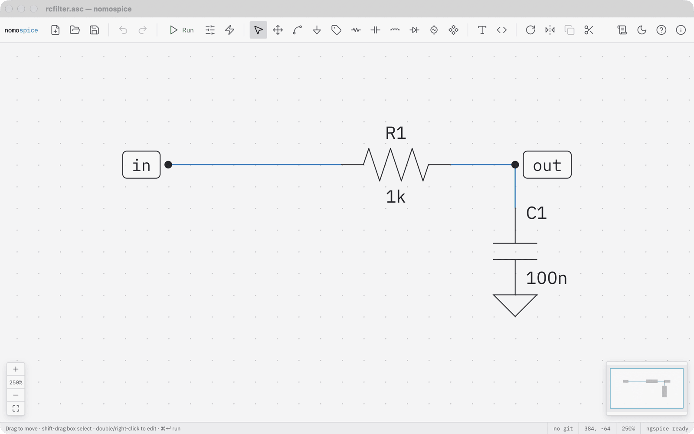
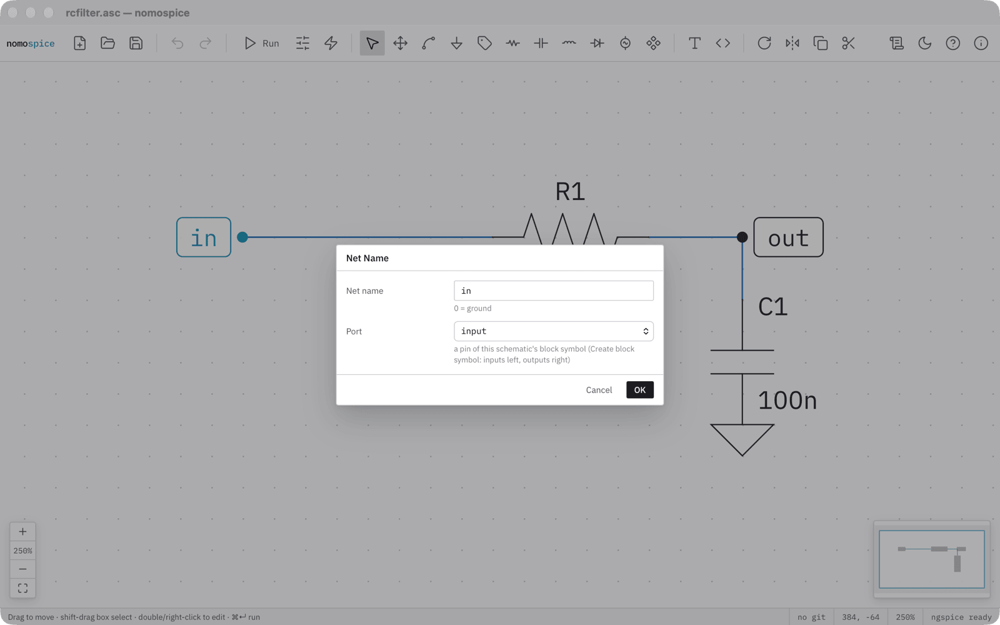
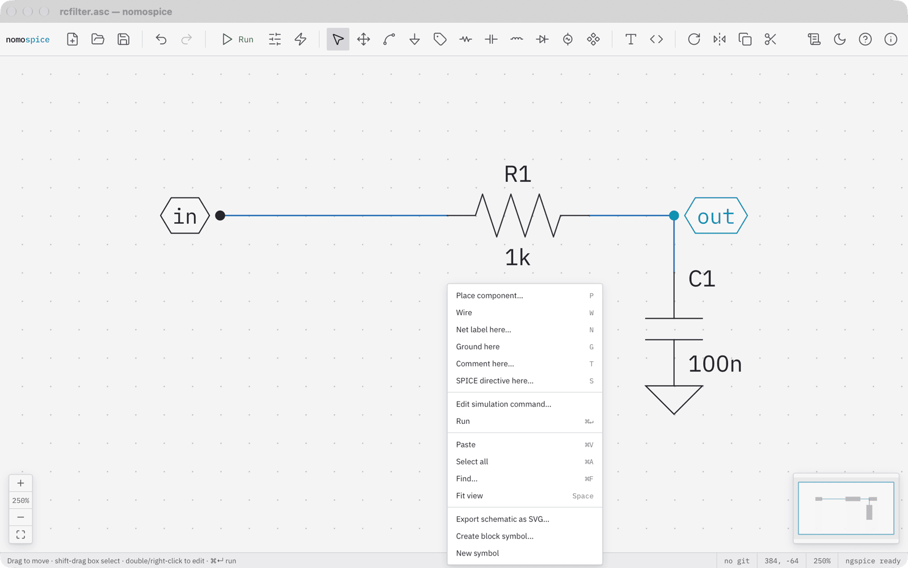
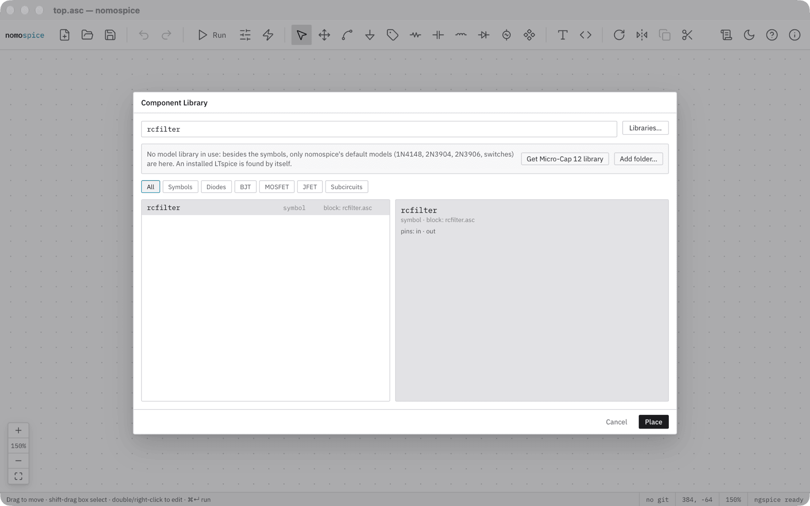
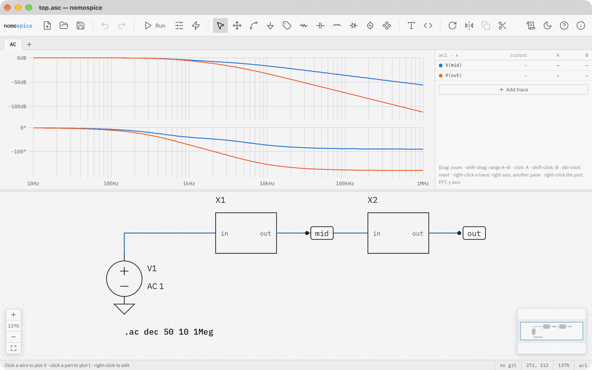
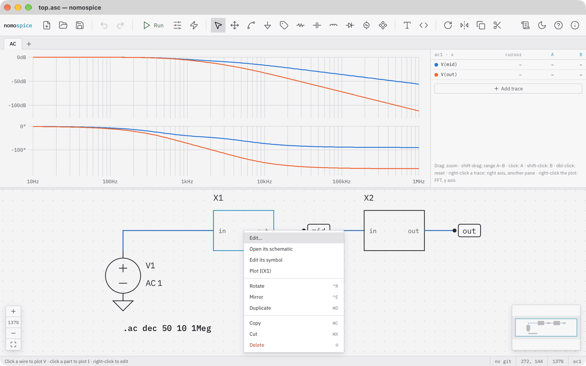
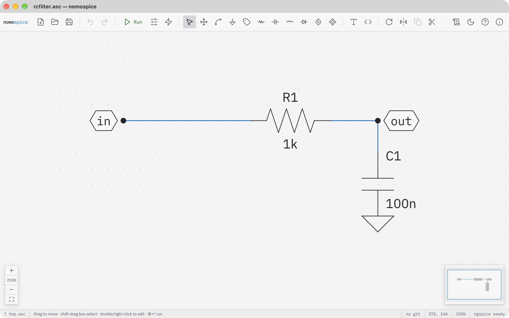
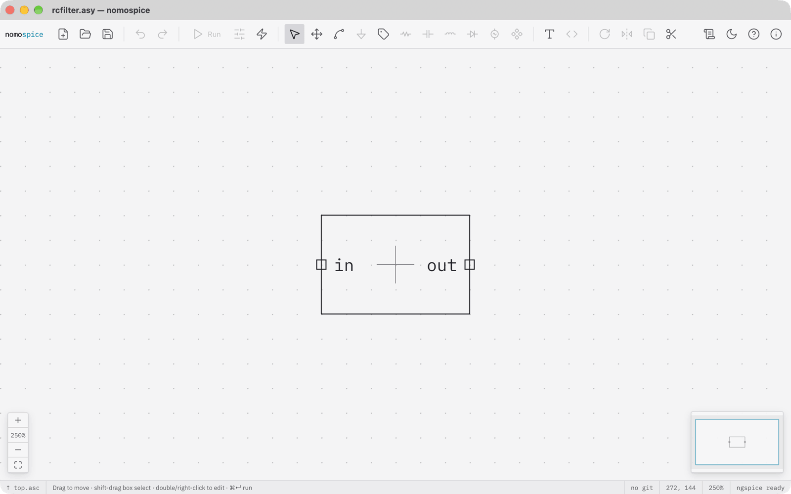

# Your own block

In this tutorial you turn the RC low-pass into a block: a part with its own symbol that stands for its schematic. You place it twice in another schematic to make a second-order filter, look inside it, and open its symbol in the symbol editor.

Start with the filter alone: the resistor, the capacitor to ground, and the labels in and out, without the source. Save it as rcfilter.asc in a folder of its own. The file name becomes the name of the block.

## Mark the ports

The labels are how the block connects to the outside. Double-click the label in and set its Port to input. Set the port of out to output in the same way. Ports are drawn as hexagons. Save the schematic.

Right-click an empty spot of the canvas and choose Create block symbol. nomospice writes rcfilter.asy beside the schematic: a box with the inputs on the left and the outputs on the right.

## Use the block

Make a new schematic with ++cmd+n++ and save it in the same folder: a block is found beside the schematic that uses it. Press ++p++ for the component library. Search for rcfilter: it is listed as a block of rcfilter.asc, with its pins in and out. Place it like any other part.

Here two blocks are placed in series and driven by an AC source. Each block runs as a subcircuit of its schematic. The output falls off twice as steeply as one filter alone, 40 decibels per decade, and the label mid shows how the second filter loads the first.

!!! tip "Parameters"
    A block can take parameters: give the block the Value `R=10k` and use `{R}` in its schematic. A `.param R=1k` in the block's schematic is the default.

## Look inside

Right-click a block. Its menu can open the block's schematic and edit its symbol.

Open its schematic: nomospice shows rcfilter.asc in place of the schematic above, and the status bar shows the way back up. Click it to return.

Edit its symbol: the symbol opens on the canvas. Draw lines with the wire tool, add pins with the label tool, move and delete them like parts, and set the symbol's attributes from the canvas menu. Saved, the symbol is redrawn in every schematic of its folder.

## What you have done

- marked labels as ports and made a block symbol from a schematic;
- placed the block twice and simulated the hierarchy;
- opened a block's schematic and its symbol.

That is the end of the tutorials. The [how-to guides](../how-to/index.md) show how to do particular tasks, and the [reference](../reference/index.md) lists every key, menu and directive.
