# Your first simulation

In this tutorial you draw an RC low-pass filter, feed it a sine wave and look at what comes out: the two voltages, a current, and the delay between input and output. It takes about ten minutes.

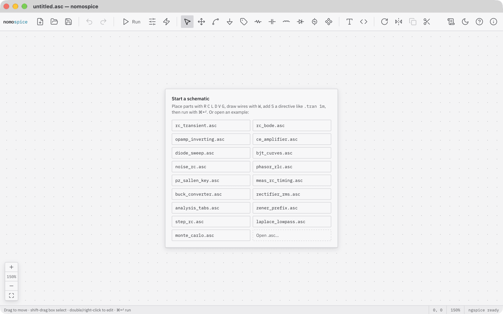

When nomospice starts, it shows an empty schematic and a list of examples. You will start from scratch.

## Place the parts

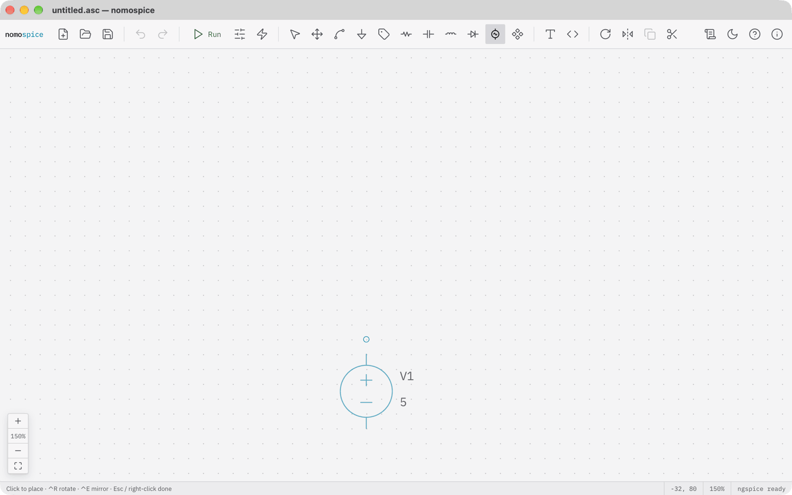

Press ++v++ to pick up a voltage source. It follows the mouse. Click to put it down.

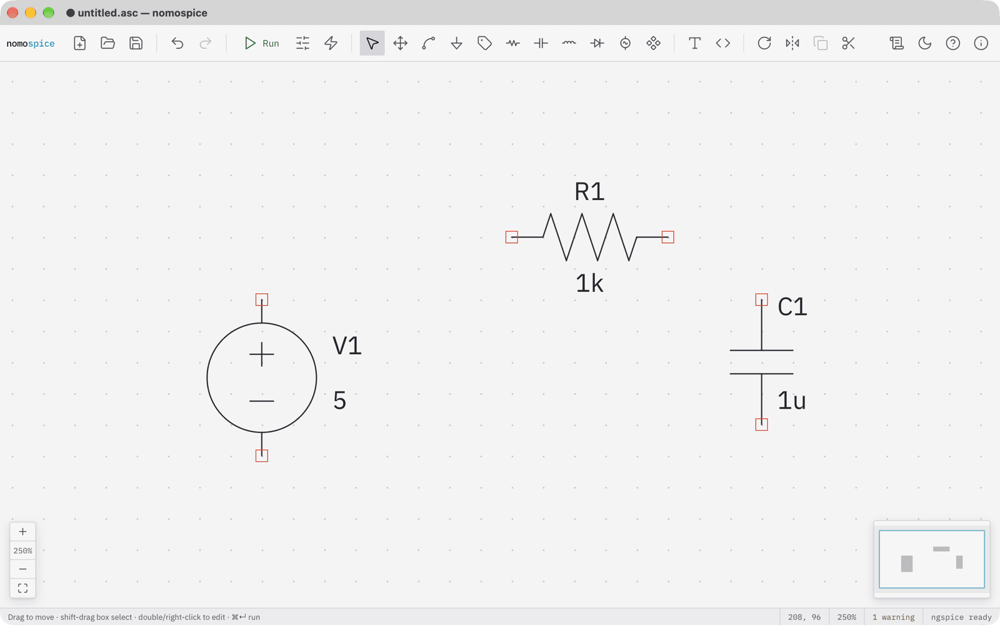

Press ++r++ for a resistor, and ++ctrl+r++ to turn it on its side before you click. Then press ++c++ for a capacitor. Press ++esc++ when you are done placing, and the space bar to fit the view. nomospice names the parts V1, R1 and C1 and gives each a default value.

## Wire them up

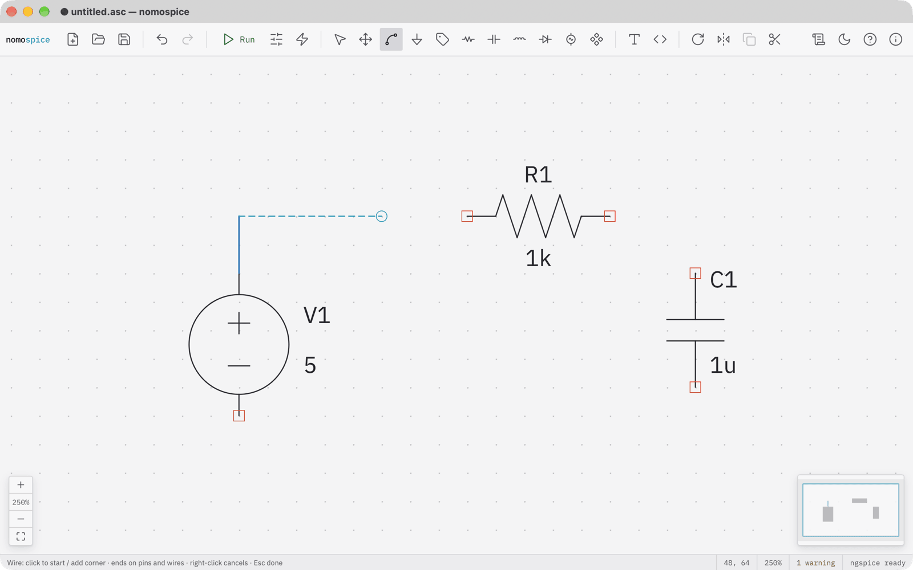

Press ++w++ for the wire tool. Click the top of the source, click again where the wire turns the corner, and click the left end of the resistor. The wire ends there because it reached a pin. Draw the second wire from the right end of the resistor to the top of the capacitor.

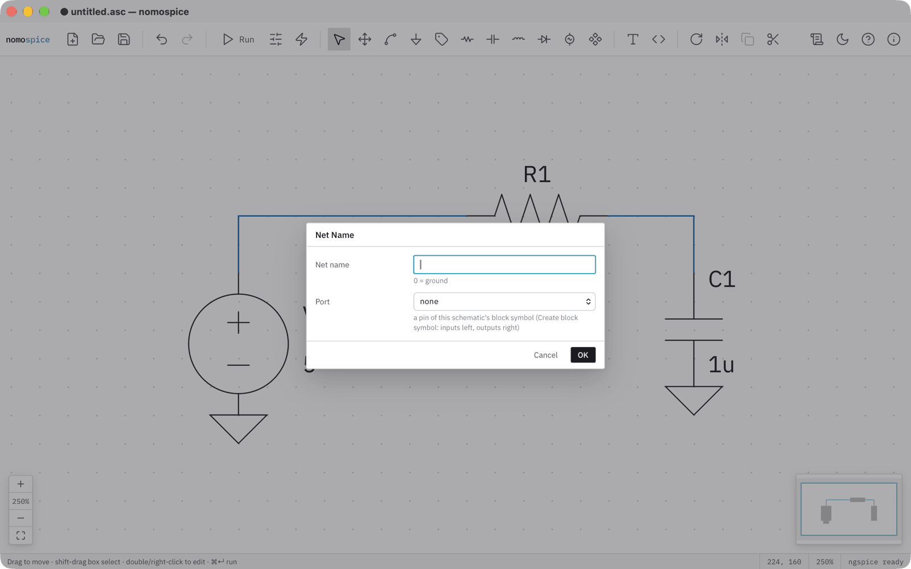

A circuit needs a ground. Press ++g++ and click under the source and under the capacitor. Then press ++n++ to name a net: enter the name `in`, click OK, and click the wire at the top of the source.

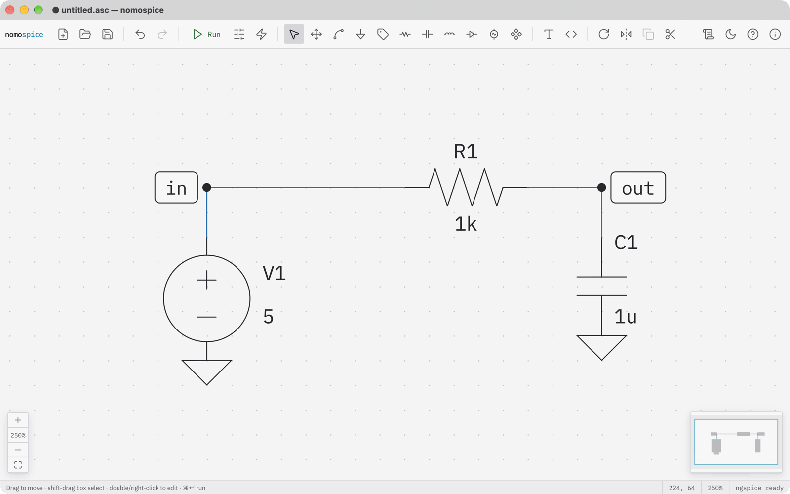

Name the other net out in the same way. Named nets are easier to find in the results, and the first run plots them for you.

## Set the values

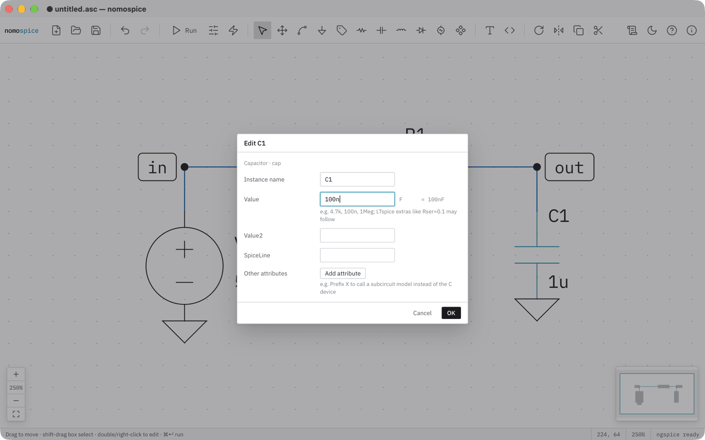

Double-click the capacitor and type 100n. Next to the field, nomospice shows how SPICE reads it: 100 nanofarads.

!!! warning "1M is not a megohm"
    SPICE ignores case, so `1M` means one *milli*. Write `1Meg` for a million. The dialog warns you and offers the fix.

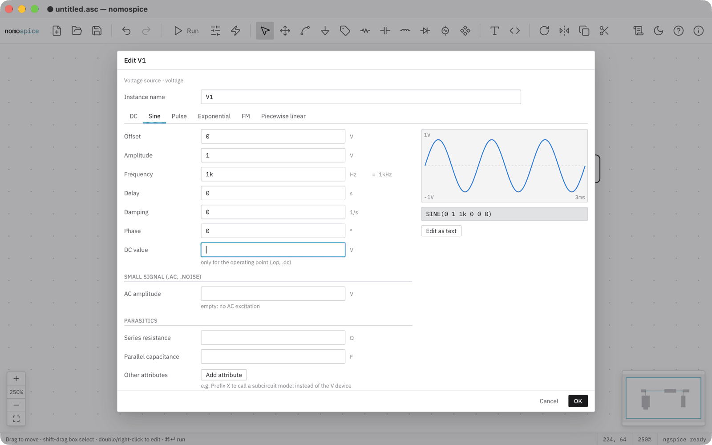

Double-click the source and choose Sine: an amplitude of 1 volt at 1 kilohertz. The preview shows the waveform, and the line below it shows the SPICE text the form writes.

## Run the simulation

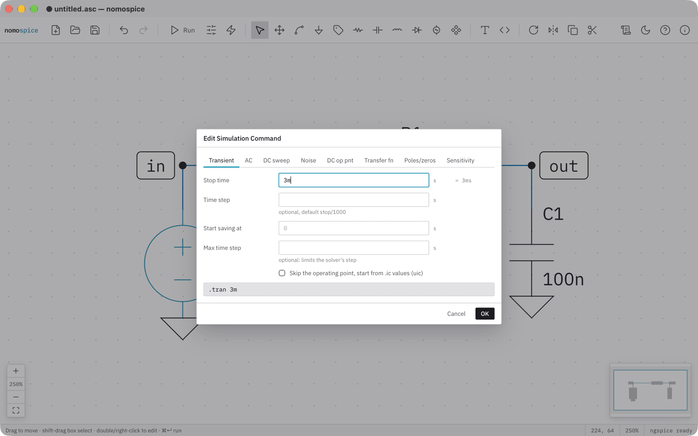

Click the sliders in the toolbar to edit the simulation command. Choose Transient and a stop time of 3m, three milliseconds. Click OK, then click into the schematic to place the directive.

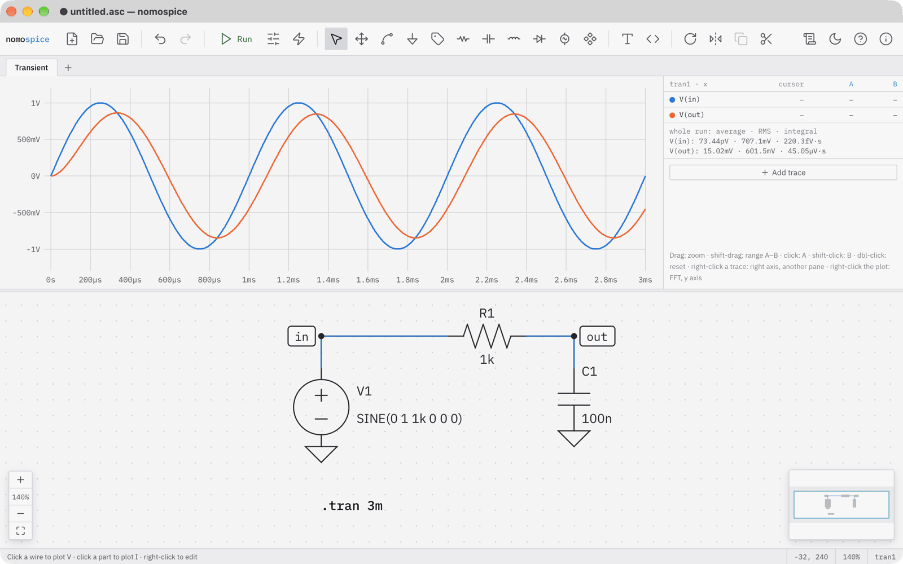

Press ++cmd+enter++ to run. The plot opens above the schematic with the voltages of the two named nets: the input sine, and the output, smaller and a little later.

## Probe and measure

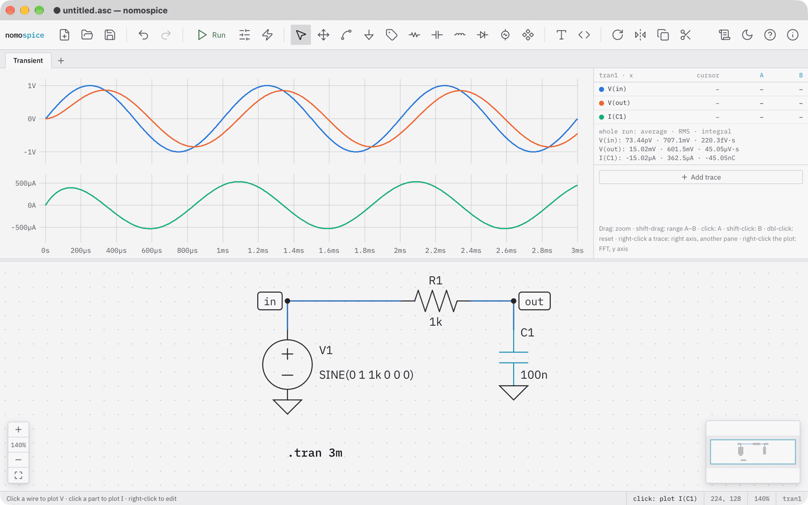

Click the capacitor. Its current is added to the plot, in a pane of its own because it is a current, not a voltage. Clicking a wire plots its voltage the same way.

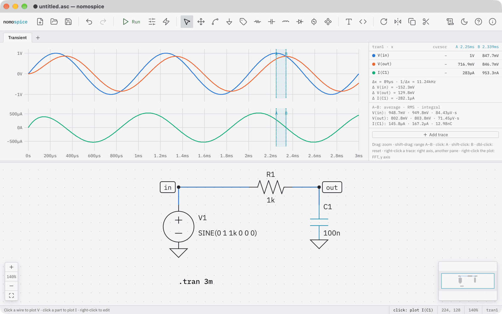

Click the plot to set cursor A, and shift-click to set cursor B. The table beside the plot shows each trace at both cursors and the difference between them. Here the output peaks 89 microseconds after the input: a phase of 32 degrees, just as the arctangent of 2πfRC predicts.

## What you have done

- placed parts with single keys, turned one with ++ctrl+r++, and wired them;
- named nets and set values in forms that show the SPICE text they write;
- run a transient analysis, probed a current by clicking a part, and measured with cursors.

Press ++cmd+s++ to save the schematic as an `.asc` file. On Windows and Linux, use ++ctrl++ wherever this guide says ++cmd++.

Next: [Frequency response](frequency-response.md) looks at the same filter in the frequency domain.
