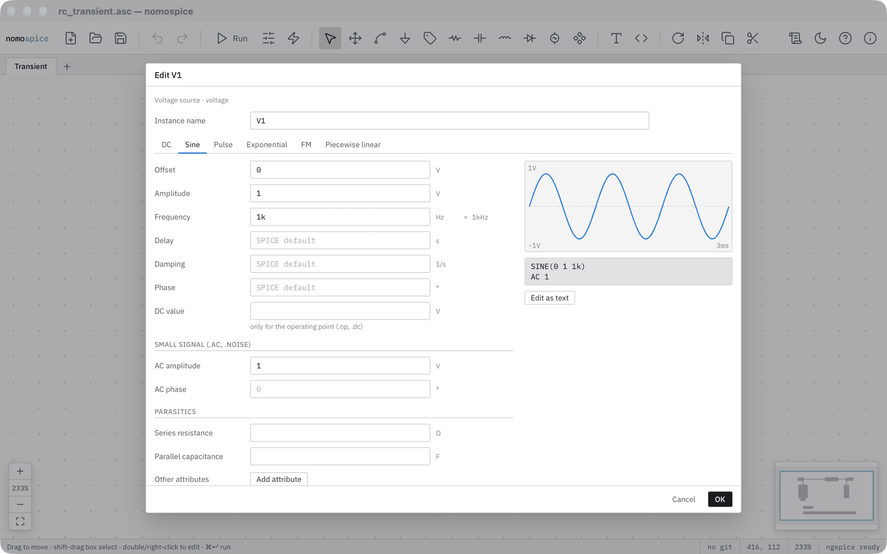
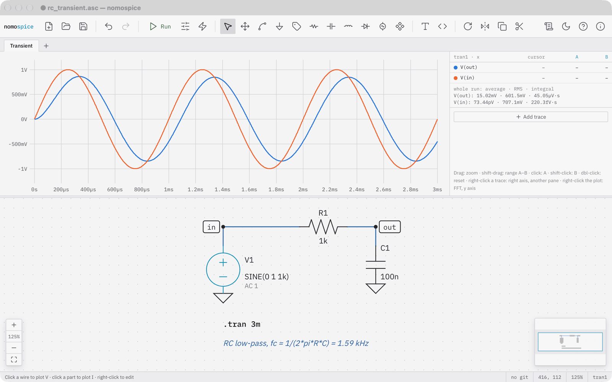
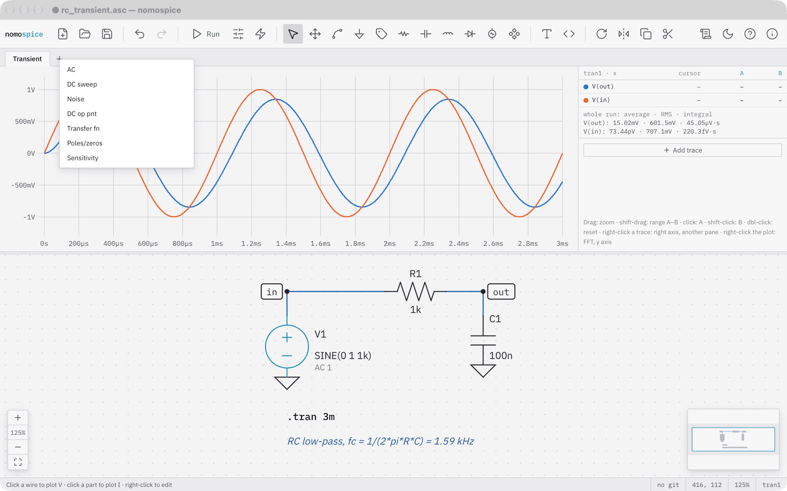
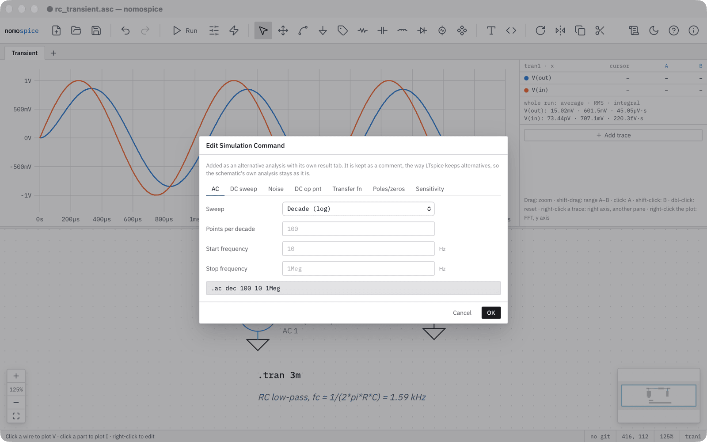
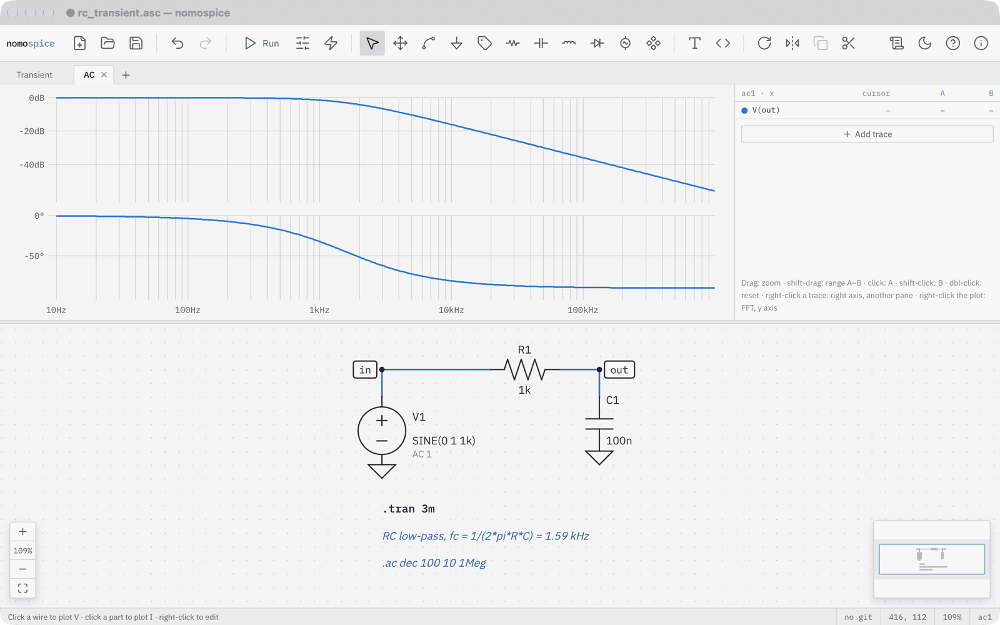
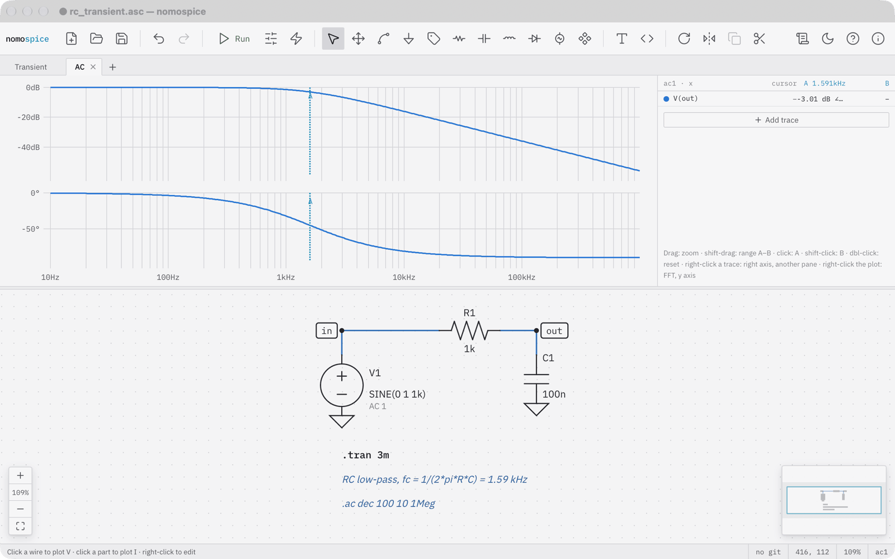
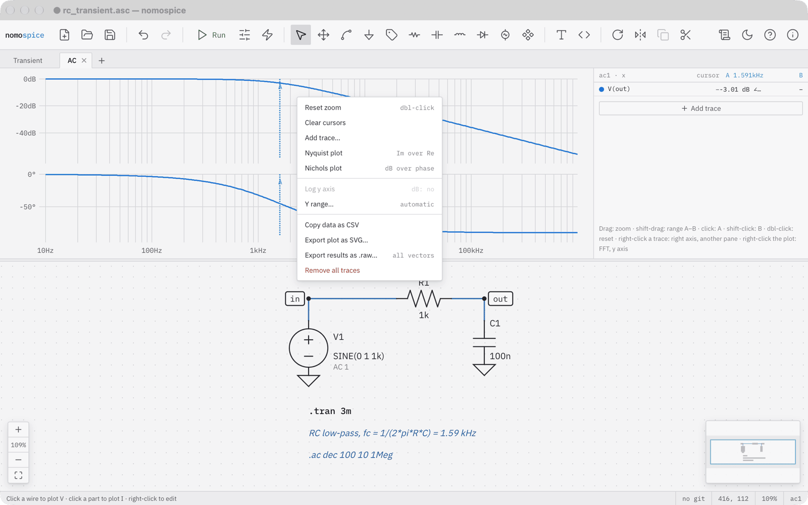
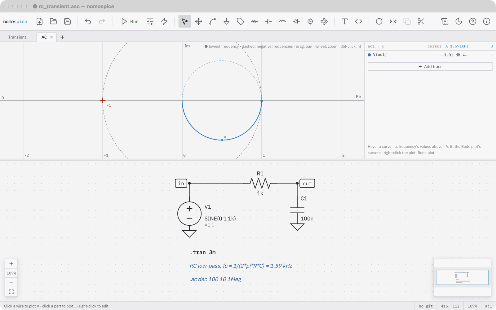
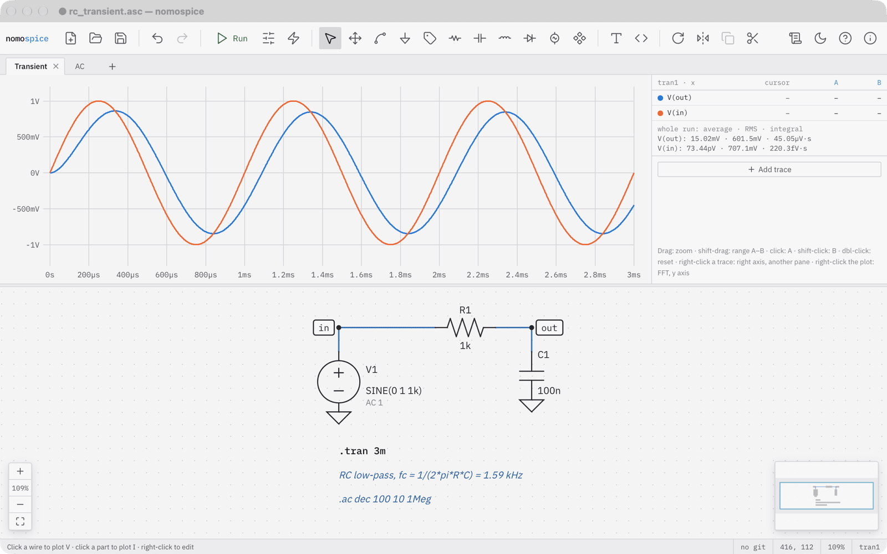

# Frequency response

In this tutorial you look at the RC low-pass of the [first tutorial](first-circuit.md) in the frequency domain: its Bode plot, its corner frequency, and its Nyquist plot. You keep the transient analysis as well, each in a result tab of its own.

Open the filter you saved, or the example rc_transient from the start screen. An AC analysis needs a source that drives it: double-click the source and enter an AC amplitude of 1. The sine stays for the transient analysis; the AC amplitude counts only in AC and noise analyses.

Press ++cmd+enter++ to run the transient analysis once more. Its result tab, Transient, sits above the plot.

## Add an AC analysis

Click the plus beside the Transient tab to add an analysis.

Choose AC. The form suggests a sweep of 100 points per decade from 10 hertz to 1 megahertz, which suits this filter. Click OK. nomospice writes the new analysis under the transient one as a comment, so the schematic's own analysis stays as it is, and gives it a result tab of its own, which opens and runs at once.

## Read the Bode plot

The AC tab's plot has two panes over a logarithmic frequency axis: the magnitude in decibels and the phase in degrees. The input is a flat line at 0 decibels and is left out; the output falls off above about a kilohertz.

Click the plot at about 1.59 kilohertz to set cursor A. The table shows −3 decibels and −45 degrees there: the corner frequency, 1 over 2π R C.

## Other views

Right-click the plot for its menu. Besides zoom, cursors and exports it offers two other views of an AC result: the Nyquist plot and the Nichols plot.

The Nyquist plot draws the imaginary part over the real part. A first-order low-pass is a half circle from 1 at low frequencies to 0 at high ones; cursor A is at its lowest point, the corner frequency. The cross at −1 is the point that matters for the stability of loops.

Click the Transient tab: its traces, zoom and cursors are as you left them. Each tab keeps its own results.

## What you have done

- given a source an AC amplitude for small-signal analyses;
- added a second analysis as a result tab, and switched between the two;
- read a corner frequency from the Bode plot, and seen the same result as a Nyquist plot.

Next: [Sweeps and measurements](sweeps.md) runs the filter for several capacitor values and measures each.
