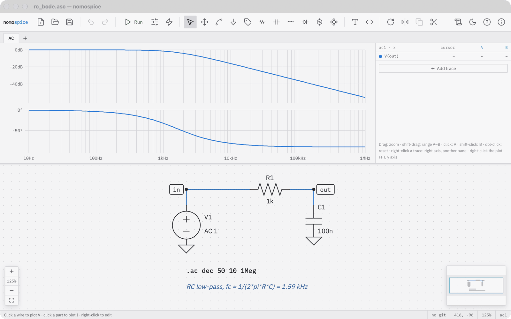
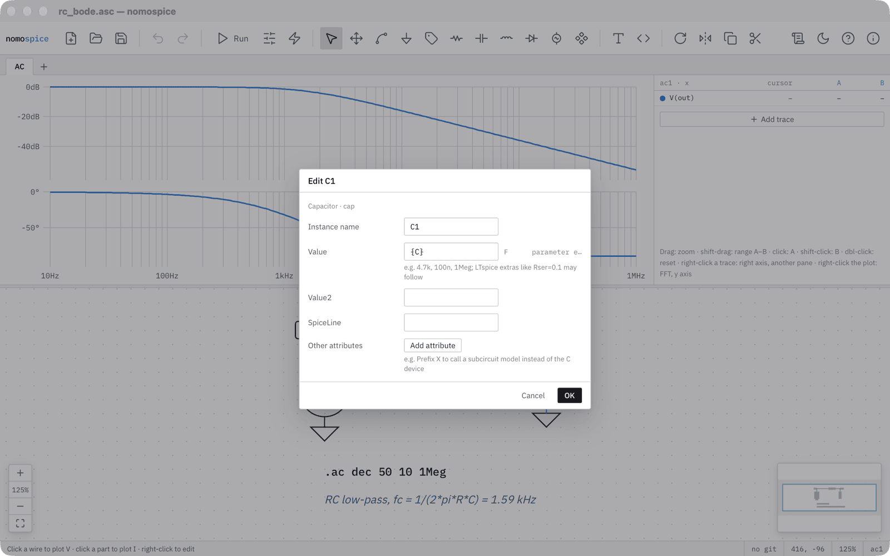
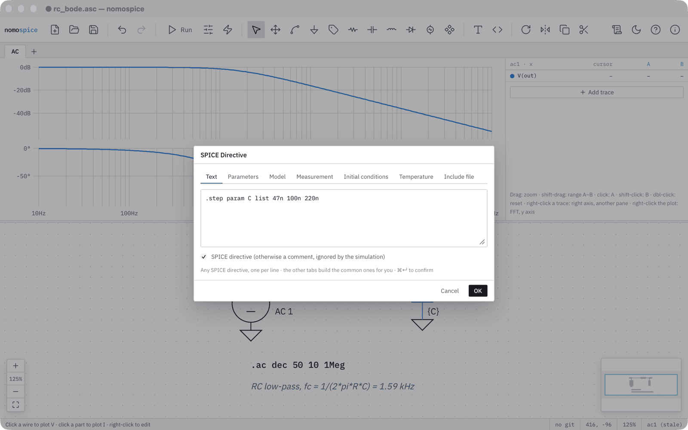
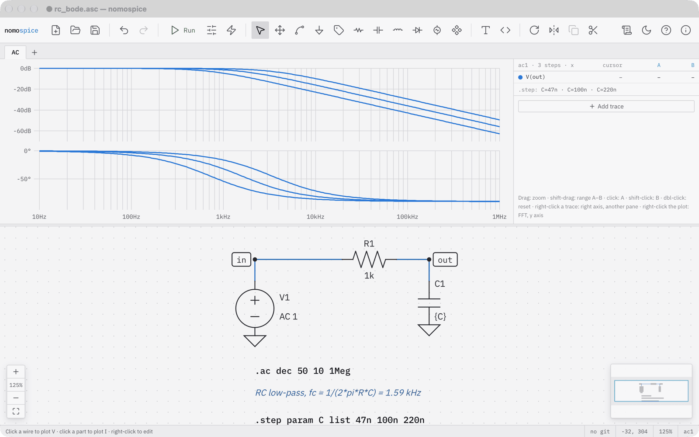
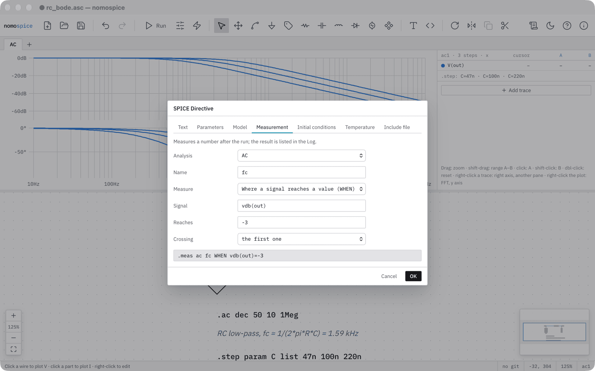
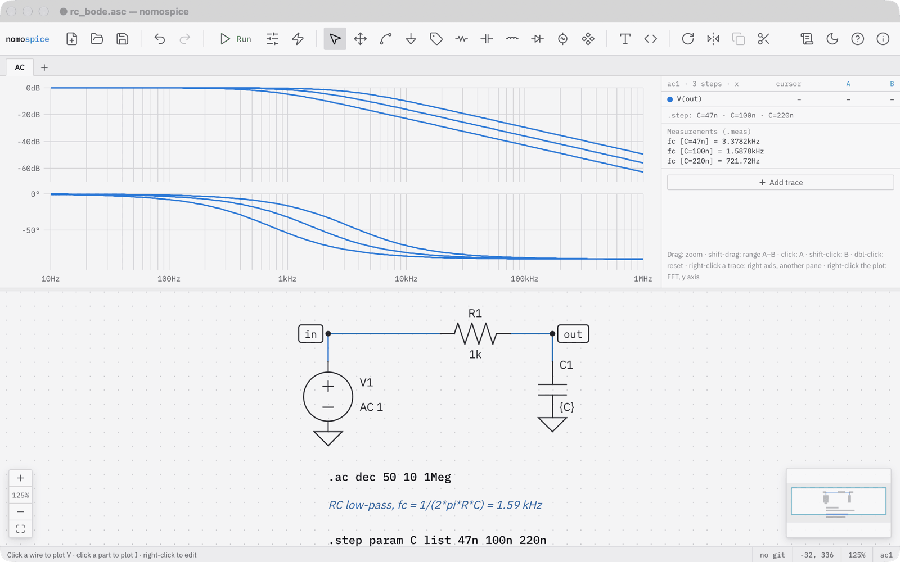
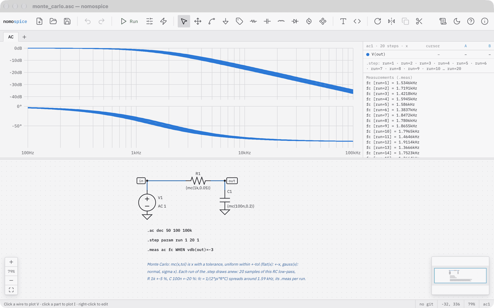

# Sweeps and measurements

In this tutorial you run the RC low-pass for three capacitor values at once and let nomospice measure the corner frequency of each. At the end you see the same idea used for tolerances: a Monte Carlo analysis.

!!! tip "As a video"
    <video controls preload="none" poster="../img/sweeps/06-measured.png" style="width: 100%">
      <source src="../videos/sweeps.mp4" type="video/mp4">
      <track kind="captions" src="../videos/sweeps.vtt" srclang="en" label="English">
    </video>
    The same tutorial [on YouTube](https://youtu.be/uqluq9GN9lg). Its narrator's voice is synthetic.

Open the example rc_bode from the start screen and run it. It is the filter of the previous tutorials with an AC analysis.

## Make the value a parameter

Right-click the capacitor and choose Edit. Instead of a number, give it the value C in curly braces. The braces tell SPICE that this is an expression, here a parameter named C.

## Sweep it

Press ++s++ for a SPICE directive, and type a step command: dot step, param C, list 47n 100n 220n. Click OK and place it under the other directives.

Run it. The analysis now runs once for each value, and every trace becomes a family of curves. The table beside the plot lists the steps.

## Measure

Press ++s++ again and choose the Measurement tab. Name the result fc, and measure where a signal reaches a value: the output in decibels, vdb of out, reaching −3. The line below shows the dot meas command the form writes. Click OK and place it.

Run once more. The measurements appear beside the plot, one per step: 3.38 kilohertz for 47 nanofarads, 1.59 kilohertz for 100, and 722 hertz for 220, as 1 over 2π R C predicts.

## Tolerances: Monte Carlo

The same mechanism handles tolerances. Open the example monte_carlo: its resistor is mc of 1k and 0.05, a value drawn anew within 5 percent in every run, and its capacitor varies by 20 percent. A step over a dummy parameter, run 1 to 20, repeats the analysis twenty times, and the measurement gives the spread of the corner frequency.

## What you have done

- used a parameter in curly braces as a part's value;
- swept it with a step directive into a family of curves;
- measured a quantity per step with a meas directive, written by a form;
- seen tolerances simulated as a Monte Carlo analysis.

Next: [Your own block](blocks.md) turns the filter into a part you can place in other schematics.
